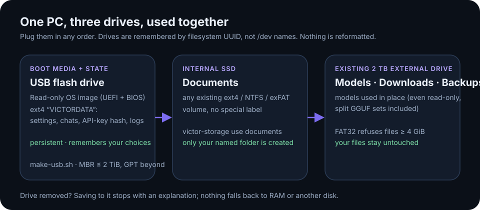
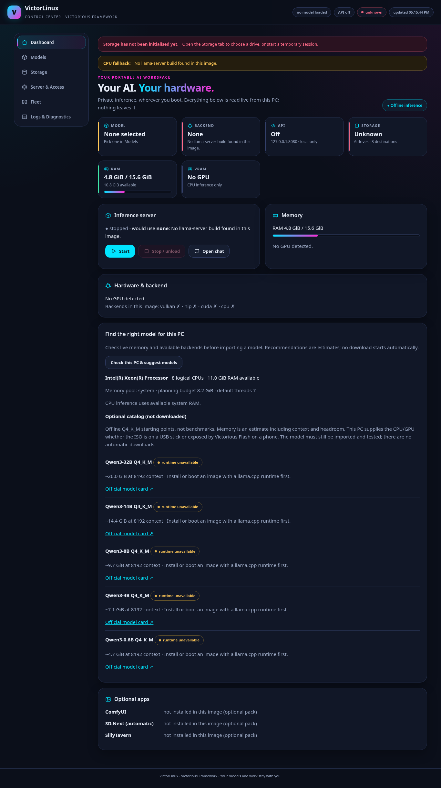
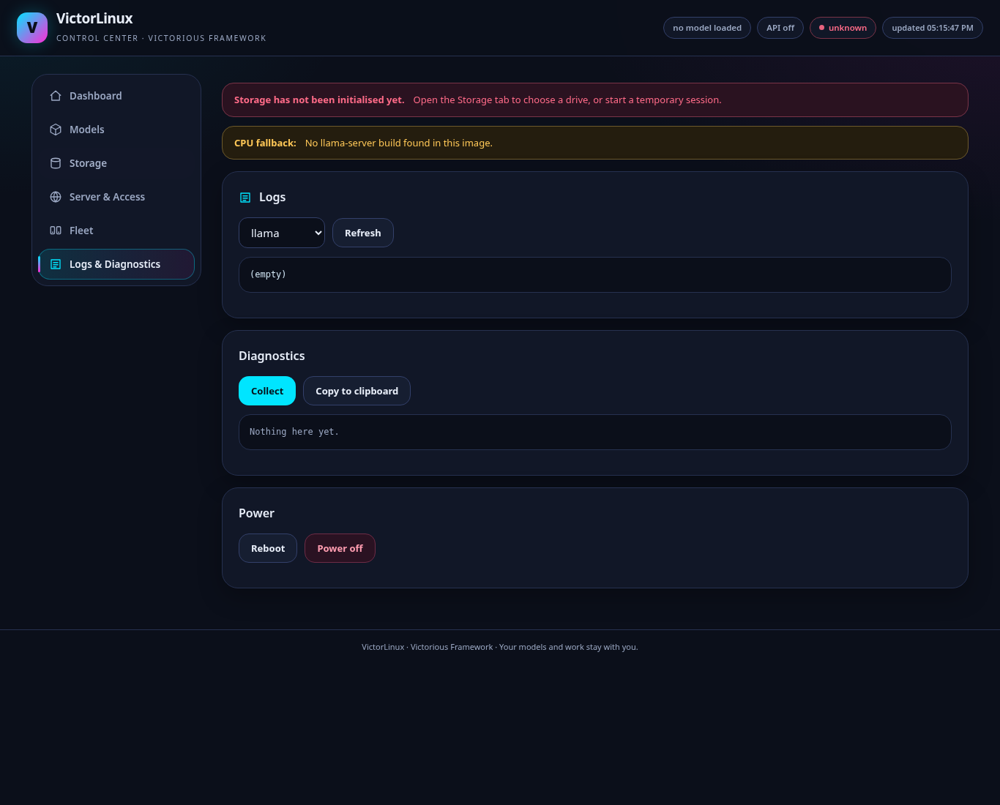

<div align="center">

# VictorLinux

**A portable, private AI workstation. Boot from a USB stick, keep your files on the drives you already own.**

[](https://github.com/Victorious93/VictorLinux/actions/workflows/validate.yml)
[](LICENSE)

[Storage](#use-the-storage-you-already-own) · [Quick start](#quick-start) · [Editions](#choose-an-edition) · [Boot media](#boot-media) · [Capacity & filesystems](#capacity-and-filesystems) · [Troubleshooting](#troubleshooting) · [Docs](#documentation) · [Status](#status-and-testing)

*Victorious Framework · Offline inference on the PC's own CPU, RAM and GPU · Dark by design*

</div>

<p align="center"></p>

VictorLinux boots a PC from a USB drive, or from an ISO exposed by [Victorious Flash](https://github.com/Victorious93/victorious-flash) on a supported rooted Android phone.
Inference runs on the **PC's** hardware, with no telemetry, no automatic downloads and no cloud fallback. It is maintained by **Victorious / Victorious Framework** and is the
renamed Victorious fork of [sasha0552/ToriLinux](https://github.com/sasha0552/ToriLinux); original MIT attribution is preserved in [LICENSE](LICENSE) and [NOTICE](NOTICE).

## Features

| | |
|---|---|
| **Private local AI** | llama.cpp with CPU and Vulkan builds (optional NVIDIA CUDA / HIP), automatic backend, GPU offload and context sizing from the hardware you actually booted |
| **Models you already have** | GGUF models used **in place** from any drive, including read-only drives and complete split sets; offline model advisor; [model library](docs/model-library.md) with background SHA-256 integrity checks, remembered per-model settings and "worked on this PC" history |
| **Any drive, any size** | Storage chosen by detected capacity and capability. USB, internal SATA/NVMe, external SSD/HDD and SD cards, simultaneously; boot-media preparation for multi-terabyte drives |
| **Control Center** | Local web UI in the VictorLinux palette (#0B0F1A, cyan #00E5FF, magenta #FF2BD6) with a live status dashboard (model, backend, API, storage, RAM/VRAM), keyboard navigation and responsive layout, plus CLI: `victor-open`, `victor-storage`, `victor-hardware`, `victor-diag` |
| **Optional API** | Authenticated OpenAI-compatible endpoint for DroidCommand-AI, VictorSuite, [Victorious Browser](https://github.com/Victorious93/victorious-browser); the admin UI never leaves `127.0.0.1` |
| **Fleet** | Coordinate 3–4 phones ([fleet integration](docs/fleet-integration.md)) |

<p align="center"></p>

## Choose an edition

| | Arch edition (repository root) | [Debian edition](debian-edition/README.md) |
|---|---|---|
| Desktop | Openbox + local web Control Center | Xfce + Tk Control Center |
| Appearance | Brand palette (#0B0F1A / #00E5FF / #FF2BD6) in the web Control Center, Openbox root and Konsole; dark GTK | Same palette in the Tk Control Center (status strip), Xfce desktop, terminal and greeter |
| Inference | Separate CPU/Vulkan builds; optional NVIDIA CUDA and HIP | CPU + Vulkan; optional NVIDIA driver profile |
| Launch | `victor-open` | `victor-control` |
| Multi-drive storage destinations | **Yes** (this page) | Not yet: keeps its own `VICTORDATA` layout |
| Boot-media tool | `scripts/make-usb.sh` (MBR ≤ 2 TiB, GPT beyond) | `debian-edition/scripts/provision-usb.py` (Ventoy; unchanged, not re-tested for multi-TB) |
| Variants | GUI, headless, empty | GUI; headless is on the [roadmap](debian-edition/docs/ROADMAP.md) |

The editions can recognise the same data-partition label but have **different configuration and chat layouts**, and do not migrate each other's settings.

## Use the storage you already own

Boot from a **USB flash drive**, keep documents on the PC's **internal SSD**, and put models, downloads and backups on your **existing 2 TB external drive**, all at once.
The data drives do **not** need VictorLinux on them, a special label or a dedicated format. Their contents are preserved. Picking a folder only creates the folder you name; it never formats,
repartitions, relabels, re-owns or erases anything.

```sh
victor-storage list                                                       # every internal, external, USB and SD volume
victor-storage use models    "Seagate 2TB" --folder "LLM library"          # external drive: models used in place
victor-storage use documents <UUID-of-internal-SSD> --folder "Documents"   # internal SSD
victor-storage use backups   "Seagate 2TB" --folder Backups
victor-storage status                                                     # what is active, persistent or temporary
```

Reconnect later in any port or order and the choices come back: drives are remembered by **filesystem UUID**, never `/dev/sdX`.
The same screen is in the Control Center's **Storage** tab (same code behind both).

| | What it holds | Where it lives | How you choose it |
|---|---|---|---|
| **Boot media** | read-only OS image | USB stick, or a phone exposing the ISO | [`scripts/make-usb.sh`](docs/usb.md) (erases the target) |
| **Persistent application state** | settings, chats, API-key hash, TLS key, logs | one ext4/btrfs/xfs volume, normally `VICTORDATA` on the stick | automatic by label, or `victor-storage state DRIVE` |
| **Model libraries** | GGUF files, split sets | any supported volume, used in place, read-only is fine | `victor-storage use models DRIVE --folder DIR [--read-only]` |
| **Ordinary file destinations** | documents, downloads, outputs, backups | any supported writable volume | `victor-storage use documents\|downloads\|outputs\|backups DRIVE …` |

If a chosen drive is unplugged, saving to it **stops with an explanation**: nothing is silently written to RAM or another disk. Duplicate UUIDs or labels are reported, never guessed.
FAT32 refuses single files of 4 GiB or more *before* a copy starts. Details, behaviour table and limits: **[docs/storage.md](docs/storage.md)**.



*Real Control Center rendered by `tests/browser_ui.js` with fixture data (no physical drives). The two banners at the top come from the test harness having no real storage state.*

## Quick start

1. **Build or obtain an ISO.** No VictorLinux release has been published yet; build it (needs internet at build time, the image runs offline): see [build details](docs/build.md).

   ```sh
   scripts/build.sh amd gui          # out/victorlinux-*.iso + checksum, manifest, package list, build log
   scripts/build.sh universal gui    # alias of cuda: adds the NVIDIA stack (supported generations follow that driver)
   ```

2. **Prepare the boot stick** (erases it; read [boot media](docs/usb.md) first):

   ```sh
   sudo scripts/make-usb.sh list
   sudo scripts/make-usb.sh plan  --iso out/EXACT-victorlinux-image.iso --device /dev/sdX
   # Only after checking the plan and backing up the target:
   sudo scripts/make-usb.sh write --iso out/EXACT-victorlinux-image.iso --device /dev/sdX --confirm-serial ACTUAL_SERIAL
   ```

3. **Boot** the PC from the stick (firmware boot menu), run `victor-open`, choose storage, import or select a GGUF model, press **Start**.

## Boot media

| Method | Status |
|---|---|
| **USB stick, raw hybrid image + `VICTORDATA`** (`make-usb.sh`, default) | UEFI + BIOS; layout planner and GPT path tested on loop devices and in QEMU with a generic test image; the VictorLinux ISO on real hardware is **not** verified |
| **USB stick written by [Victorious Flash](https://github.com/Victorious93/victorious-flash)** (desktop or Android OTG) | Works for ordinary media; Flash has **not** been updated for drives above 2 TiB ([what is needed](docs/flash-companion-changes.md)) |
| **Phone as read-only boot medium** (rooted Android, USB gadget) | Unchanged. Persistence comes from a **separate** writable drive; any ext4/btrfs/xfs volume can be the state drive |
| Ventoy (`--layout ventoy`) | Optional. An earlier UEFI boot failure with this ISO is **unresolved** |
| Flash's no-root HTTP/EFI path | Ubuntu/casper only; **not supported** for VictorLinux |

Phone gadget mode (phone is the USB *device*) and OTG (phone is the USB *host*) cannot both use one port. Keep the phone connected until the PC has shut down.

## Capacity and filesystems

**Minimum drive** = image + 2 GiB data + 1 GiB reserve (both adjustable). For a ~1.8 GiB image that is about **4.8 GiB**, so a nominal 4 GB stick is refused. `plan` prints the exact figure for your ISO.
Sizes come from the measured device, not the label; there is no 64/128 GB table and no upper limit in the planner.

| Marketed | Table | Data partition (1.8 GiB image) |
|---|---|---|
| 8 GB | MBR | 4.7 GiB |
| 64 GB | MBR | 56.8 GiB |
| 128 GB | MBR | 116.5 GiB |
| 1 TB / 2 TB | MBR | 928.6 GiB / 1,859.9 GiB |
| 4 TB / 8 TB / 16 TB | **GPT** | 3,722.5 / 7,447.8 / 14,898.4 GiB |

Above 2 TiB the MBR's 32-bit fields cannot describe the drive, so the tool builds a **GPT that keeps the image's own boot structures** (it does not blindly convert them), validates everything before erasing,
refuses 4Kn media for boot (512e is fine) and verifies the image payload afterwards. Use `--data-gib N` to keep the rest unallocated. See [docs/usb.md](docs/usb.md).

| Filesystem | Models & files | App state | Notes |
|---|---|---|---|
| ext4, Btrfs, XFS | ✅ | ✅ | Btrfs/XFS existing behaviour retained |
| exFAT | ✅ | ❌ | no Unix permissions |
| NTFS | ✅ | ❌ | read-only if Windows left it hibernated or unclean; never forced |
| FAT32 | ⚠️ files < 4 GiB | ❌ | per-file limit; a large drive can still be unable to hold a large model |
| LUKS / BitLocker | locked | – | unlock elsewhere; VictorLinux cannot unlock yet |

Support for exFAT, NTFS, FAT32, Btrfs and XFS relies on the stock kernel and packaged tools and was **not run** in the development sandbox (only ext4 could be mounted): see the [test report](docs/2026-11-15-storage-testing.md).

## Hardware adaptation and models

At every model start the PC measures itself: [hardware and model selection](docs/hardware-and-models.md) (memory pools, automatic context, threads, GPU layers, ranked local models, estimates versus verified generation, atomic split-GGUF import).
Try `victor-hardware`, or *Check this PC & suggest models* in the Control Center. A software Vulkan renderer is reported as CPU fallback; estimates are not promises that a model fits.
Import a model with `victor-model-import FILE.gguf` (or `--to-storage` for a chosen models drive). Downloading models is never automatic.

[Victorious Browser](https://github.com/Victorious93/victorious-browser) (Android) is the phone companion (Tools → VictorLinux PC): see the [companion API](docs/companion-api.md). It is an Android app, not a Linux desktop browser.

## Troubleshooting

| Symptom | Check |
|---|---|
| "No persistent storage found" | `victor-storage list`. A `VICTORDATA`/`TORIDATA` ext4 volume, or exactly one Linux volume that already has a `victorlinux/` folder, is found automatically. Otherwise `victor-storage state DRIVE`. |
| Banner: destination **missing** | The drive is unplugged or still enumerating: reconnect, then `victor-storage apply`. |
| Destination **ambiguous** / duplicate UUID | Two drives share an identity (cloned drive). Disconnect one or give it a new UUID. |
| Drive mounted **read-only** | NTFS hibernation/unclean flag or filesystem errors. Shut Windows down fully (disable Fast Startup) and check the disk there; VictorLinux does not force or repair it. |
| File refused on FAT32 | Files ≥ 4 GiB cannot exist on FAT32. Pick ext4/exFAT/NTFS or use split GGUF shards. |
| `make-usb.sh` says "4Kn" or "GPT is required" | See [docs/usb.md](docs/usb.md): 4Kn drives are data-only; MBR-only images over 2 TiB need `--allow-mbr-cap` or a rebuilt image. |
| Stick will not boot under Ventoy/UEFI | Use the default raw layout; Ventoy UEFI is unresolved. |

## Documentation

[Storage](docs/storage.md) · [Boot media / USB](docs/usb.md) · [Build](docs/build.md) · [Hardware & models](docs/hardware-and-models.md) · [AMD GPU](docs/amd-gpu.md) · [Remote access](docs/remote-access.md) ·
[Security](docs/security.md) · [Maintenance](docs/maintenance.md) · [Fleet integration](docs/fleet-integration.md) · [Companion API](docs/companion-api.md) · [Flash companion changes](docs/flash-companion-changes.md) ·
[Debian edition](debian-edition/README.md)

## Status and testing

* **No VictorLinux release is published** and no ISO of this revision was built or booted. Earlier ISO evidence is in the [older report](docs/test-report.md) and applies to earlier artifacts only.
* **Tested for this storage change** (see the [dated report](docs/2026-11-15-storage-testing.md)): partition planner unit tests; real `make-usb.sh` runs on loop devices including a sparse 3 TiB GPT validated by `sgdisk`;
  QEMU UEFI + BIOS boots of a *generic GRUB test image* written by the same code; multi-drive storage behaviour on real ext4 block devices (simultaneous use, reconnect in a different order, removal,
  duplicates, read-only, full); the Storage tab in Chromium.
* **Not tested:** physical drives, firmware, Secure Boot, exFAT/NTFS/FAT32/Btrfs/XFS mounts, GPU inference, phone-hosted boot, the Debian edition's storage, and Victorious Flash (not part of this change).

```sh
python3 -m pytest -q tests debian-edition/tests/test_logic.py debian-edition/tests/test_layout.py
# Root + loop devices + sgdisk add the real-device tests; QEMU/OVMF/grub-mkrescue add the boot tests. Otherwise those tests skip.
# Needs Playwright and Chromium:
node tests/browser_ui.js
```

## Commands after the rename

| Previous | Now | | Previous | Now |
|---|---|---|---|---|
| `tori-open` | `victor-open` | | `tori-bench` | `victor-bench` |
| `tori-control-center` | `victor-control-center` | | `tori-capcheck` | `victor-capcheck` |
| `tori-diag` | `victor-diag` | | `tori-tls-cert` | `victor-tls-cert` |
| `tori-model-import` | `victor-model-import` | | | |

Implementation directory `/usr/local/lib/victorlinux`; account `victor`; cache `$XDG_CACHE_HOME/victorlinux`. Developer overrides: `VICTOR_DATA`, `VICTOR_RUN_DIR`, `VICTOR_LLAMA_ROOT`, `VICTOR_CC_PORT`, `VICTOR_PRIV`, `VICTOR_VOL_BASE`.
Public gateway routes are `/victor/health` and `/victor/capabilities`; the `/tori/` routes remain compatibility aliases. Existing data (`TORIDATA`, `tori/`) is reused without relabelling or moving it.
Some build metadata still names the former repository URL; this repository is [Victorious93/VictorLinux](https://github.com/Victorious93/VictorLinux).

## Credits and licenses

Original ToriLinux © [sasha0552](https://github.com/sasha0552), MIT. VictorLinux modifications © **Victorious / Victorious Framework**, same license unless a file states otherwise ([LICENSE](LICENSE), [NOTICE](NOTICE)).
Runtime and build components keep their own licenses: [llama.cpp](https://github.com/ggml-org/llama.cpp), [Arch Linux](https://archlinux.org/), [Debian](https://www.debian.org/),
[Ventoy](https://github.com/ventoy/Ventoy) (GPLv3, used unmodified as a separate tool), and the optional ComfyUI, SD.Next, InvokeAI, SillyTavern, vLLM and nvidia-pstated packs.
