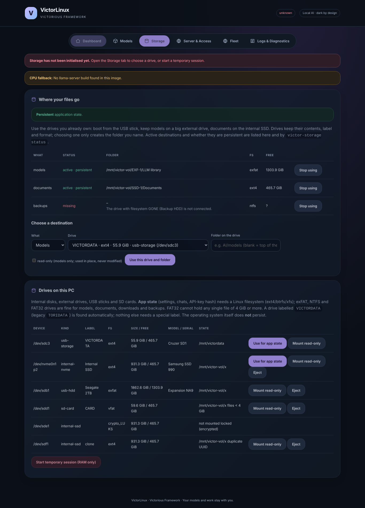

# Storage: use the drives you already own

VictorLinux boots from a USB stick (or an ISO exposed by a phone), but it does **not** insist that everything lives on that stick.
This page describes what the **Arch edition** (repository root) does today. The [Debian edition](../debian-edition/README.md) keeps its
own `VICTORDATA` layout and does not have the destination feature yet (see [Limitations](#limitations)).

```
 boot media                 application state             large files
┌──────────────┐          ┌──────────────────┐   ┌─ models ──────────► external 2 TB drive  (exFAT / NTFS / ext4 …)
│  USB stick   │ ───────► │ VICTORDATA (ext4) │ ─┼─ documents ───────► internal SSD         (any supported filesystem)
│ (read-only   │          │ settings, chats,  │   ├─ downloads ───────► any writable volume
│  OS image)   │          │ API-key hash, logs│   ├─ outputs ─────────► any writable volume
└──────────────┘          └──────────────────┘   └─ backups ─────────► any writable volume
```

The destination drives **do not need VictorLinux on them, a special label, or a dedicated format**. Selecting one only creates the folder
you name. It never formats, repartitions, relabels or erases the drive, never changes ownership of existing files, and never deletes anything.

## Four different things

| What | Holds | Lives on | Chosen how |
|---|---|---|---|
| **Boot media** | the read-only operating system image | USB stick, or a phone exposing the ISO read-only | [`scripts/make-usb.sh`](usb.md) (destructive, separate workflow) |
| **Application state** | settings, chat history, API-key hash, TLS key, logs | one **POSIX** filesystem (ext4, btrfs, xfs) – normally `VICTORDATA` on the stick | automatic by label, or `victor-storage state` |
| **Model libraries** | GGUF files, incl. complete split sets | any supported volume, used **in place** (read-only is fine) | `victor-storage use models …` |
| **Ordinary files** | documents, downloads, outputs, backups | any supported writable volume | `victor-storage use documents|downloads|outputs|backups …` |

Application state is kept apart on purpose: it needs Unix permissions, locking and atomic renames (credentials, settings). exFAT, NTFS and
FAT32 can hold models and ordinary files, but VictorLinux refuses to put application state on them.

## Quick start

```sh
victor-storage list                                   # every internal, external, USB and SD volume
victor-storage use models    "Seagate 2TB" --folder "LLM library"   # external drive, used in place
victor-storage use documents <UUID-of-internal-SSD> --folder "VictorLinux documents"
victor-storage use backups   "Seagate 2TB" --folder Backups
victor-storage status                                 # what is active, persistent or temporary
victor-storage check models 12884901888               # would a 12 GiB file fit?  (FAT32 limit, free space)
victor-storage eject "Seagate 2TB"                    # unmount before unplugging
```

The Control Center **Storage** tab does the same through the same code (`victorstorage.py`, `victor-priv`); `victor-storage status --json`
and the tab render the same dictionary. Drives are matched by **filesystem UUID**, never by `/dev/sdX`, so they can be plugged in
in any order or any port.



*The screenshot is the real Control Center rendered by `tests/browser_ui.js` with fixture data (no real drives were attached).*

## What happens when drives come and go

| Situation | Behaviour |
|---|---|
| Reboot, same drives, different port/order | Remounted by UUID. Saved folders, models and files are found again. (`victor-priv dest-apply` at boot, `victor-storage apply` at login.) |
| A chosen drive is not connected | Status **missing**; its destination resolves to **no path**. Saves/imports to it stop with an explanation. Nothing is written to RAM, the root disk or another drive. The `~/victor-storage/<what>` link dangles (writes through it fail) until `victor-storage apply` refreshes it. The dashboard shows a red banner. |
| Two drives carry the same UUID/label (clones) | Status **ambiguous**; nothing is mounted or chosen for you. Disconnect one or give it a new UUID. `victor-storage use` and `victor-priv` refuse the duplicate. |
| Two drives labelled `VICTORDATA` at boot | `ambiguous`; you must choose. |
| Volume mounted read-only / read-only device | Status **readonly**: usable for models, refused for saving. |
| Dirty or hibernated NTFS, ext4 needing repair | Mounted **read-only** with an explanation. Nothing is forced, repaired, or deleted (Windows hibernation data is left alone). |
| Encrypted volume (LUKS, BitLocker) | Listed as **locked**; not selectable. VictorLinux has no unlock feature of its own yet. |
| Volume full | Imports are refused before copying (free-space check); the status shows free space. |
| File larger than the filesystem allows (FAT32 ≥ 4 GiB) | Refused **before** the copy starts, with the reason. A big drive can still have a filesystem that cannot hold a big model. |
| Live session with no persistent state drive | **Temporary session**: state is in RAM. Destination choices still work for this session but the tool says they are lost on reboot. |
| Existing `victorlinux/` or legacy `tori/` data, `VICTORDATA` / `TORIDATA` labels | Still reused in place. A single unlabelled Linux volume that already has a `victorlinux/` or `tori/` folder is also found (read-only peek, no journal replay). |

## Filesystem support

"Writable" means the owner can read and write ordinary files. It does not mean VictorLinux formats or repairs these filesystems.

| Filesystem | Kernel driver used | Files / models | Application state | Notes |
|---|---|---|---|---|
| ext4 (and ext2/3) | `ext4` | ✅ any size | ✅ | New drives created by `make-usb.sh` use ext4. |
| Btrfs, XFS, F2FS | in-kernel | ✅ | ✅ | Existing behaviour retained; not re-tested in this change. |
| exFAT | `exfat` | ✅ any size | ❌ | No Unix permissions; mounted owned by the desktop user, files not executable. |
| NTFS | `ntfs3` | ✅ any size | ❌ | Read-only if Windows left it hibernated/unclean; Fast Startup should be off. |
| FAT32 (`vfat`) | `vfat` | ⚠️ files **< 4 GiB** | ❌ | Per-file limit 4 GiB − 1 byte. Split GGUF shards under that limit work. |
| LUKS / BitLocker | – | locked | – | Unlock elsewhere first. |

Every mount uses `nosuid,nodev,noexec`. See [the test report](2026-11-15-storage-testing.md) for what was and was **not** exercised
(ext4 was mounted and used for real; the exFAT, NTFS, FAT32, Btrfs and XFS code paths could not be run in the development sandbox, whose kernel lacks those drivers).

## Models from another drive

Add a model library with `victor-storage use models DRIVE --folder DIR` (`--read-only` for a drive you do not want touched). The Models tab then lists
GGUF files under it **in place** – nothing is copied. A complete split set (`name-00001-of-0000N.gguf` …) is listed once and is checked for missing
shards; importing copies the whole set atomically. Importing *to* a writable models destination is optional: `victor-model-import FILE.gguf --to-storage` (or the import form's *destination: storage* request field).

## Security

* All privileged work goes through the one validated helper (`victor-priv`, sudo-limited). It has no format, partition, label, fsck, `chown -R`
  or delete command, takes UUIDs (validated) and folder names (relative, no `..`, no control characters, symbolic-link escapes rejected), and never builds shell strings.
* Folder names may contain spaces and Unicode; they are never interpolated into a shell.
* The remote inference gateway and the phone-companion API expose **no** storage, file or volume route. The Control Center (which can list drives) stays on `127.0.0.1` behind a per-session token.
* Existing folders are never re-owned. If an existing folder is not writable by the desktop user, selecting it is refused with advice to pick a new name.

## Desktop programs (Save As, downloads)

`~/victor-storage/<what>` links point at the active destinations and GTK file-chooser bookmarks are added (e.g. in Firefox's Save As dialog). Volumes are
mounted under `/mnt/victor-vol/<UUID>` and are owned by the desktop user (exFAT/NTFS/FAT32) or contain the folder you asked VictorLinux to create (ext4 etc.),
so they can be browsed by any program. The Arch GUI image ships Firefox and a terminal but **no graphical file manager**; the Debian edition's Xfce file manager is not integrated with this feature yet.

## Limitations

* Arch edition only. The Debian edition keeps its own storage layer ([PERSISTENCE.md](../debian-edition/docs/PERSISTENCE.md)).
* No built-in unlock for encrypted volumes, no formatting/partition tools for data drives (by design).
* A destination is mounted when VictorLinux uses it or at boot/login. Hot-unplugging without `victor-storage eject` can lose data like on any system.
* Model files in use stay open: removing the drive mid-inference will crash that inference. Stop it first.
